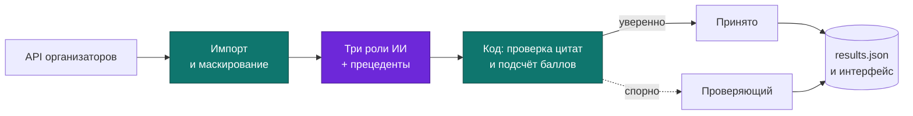
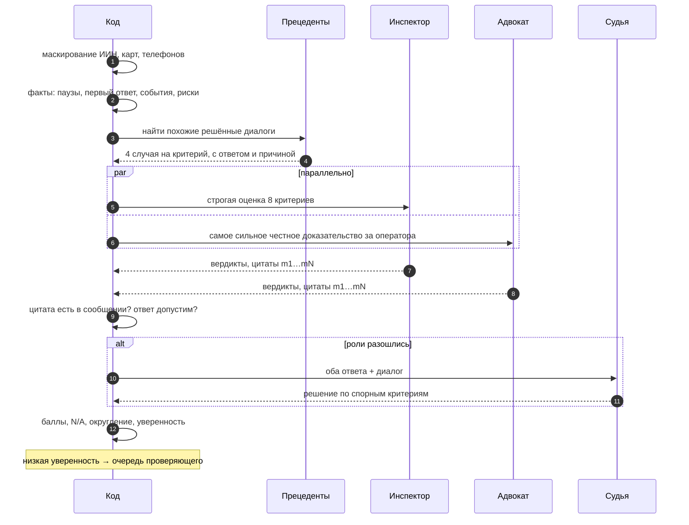
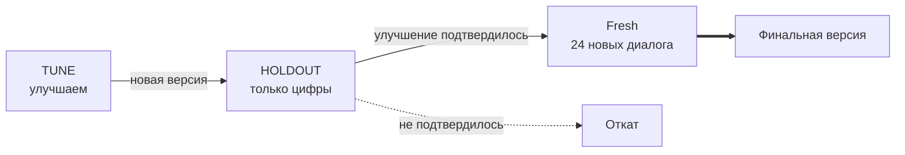
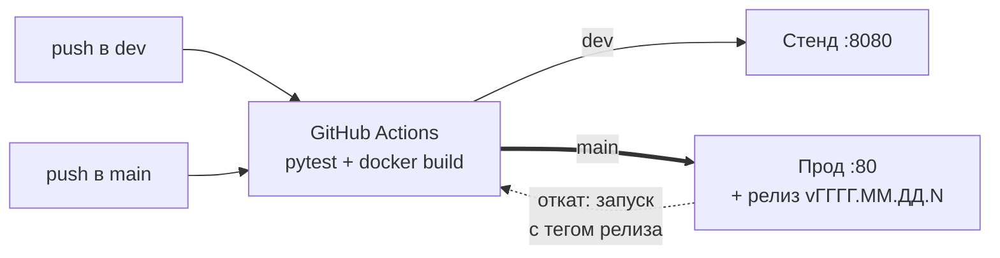

<div align="center">

# CQA · Conversation Quality Analytics

**ИИ-оценка чатов и звонков операторов на русском, казахском и английском по редактируемому чек-листу.**
У каждого вердикта есть цитата из диалога, баллы считает код, спорное решает человек.


Команда **Dreamers** · хакатон Freedom Broker CQA

</div>

---

## Что это

Проверяющий в контакт-центре читает диалог и ставит оценки по 8 критериям: контакт, выявление потребности, идентификация, консультация, эмпатия, управление диалогом, завершение, грубые ошибки. CQA делает первичную оценку за ~15 секунд: вердикт, баллы, объяснение на русском и номера сообщений, на которых основан ответ. Человек тратит время только на спорные случаи. Оператор может оспорить любую оценку, проверяющий принимает решение, итог пересчитывается.



## Результаты

Точность считается как доля критериев, где ответ системы совпал с эталоном. Эталон мы сделали сами (раздел [«Как мы измеряли качество»](#как-мы-измеряли-качество)).

| Набор | Что это | Точность |
|---|---|---|
| HOLDOUT, 109 случаев | Половина данных, на которой мы ни разу не настраивали промпты | **93.2 %** |
| Fresh, 24 диалога | Новые диалоги, написанные после заморозки системы | **96.9 %** |
| Грубые ошибки (c08) | Доля пойманных нарушений | **100 %** |

| Стоимость и скорость | Значение |
|---|---|
| Модель | `gpt-6.1-terra`, reasoning effort `low`, все три роли |
| Цена одного диалога | **$0.023** (реальный прогон на проде, 75 диалогов за $1.69) |
| Время на диалог | 13–18 с, диалоги идут параллельно |
| 10 контрольных диалогов | ≈ 1–2 минуты |

## Как оценивается диалог



Модель вызывается только в шагах с ролями. Всё остальное делает код, покрытый тестами.

**Почему три роли.** Инспектор ищет нарушения, Адвокат ищет честные доказательства в пользу оператора. Если строгий и мягкий читатель согласны, вердикт надёжен. Если спорят, значит, место действительно неоднозначное: его разбирает Судья, а при низкой уверенности — человек. Все 8 критериев оцениваются одним вызовом на роль, поэтому выходит 2–3 вызова на диалог, а не 24.

**Почему прецеденты.** Сильная модель почти не ошибается в чтении диалога. Её ошибки — в трактовке правил: например, переспросить уже известное — это «Нет», а не N/A. Переписывать чек-лист под каждую ошибку оказалось подгонкой: на отложенных данных точность падала. Поэтому модель видит 4 похожих диалога, которые уже решили проверяющие, с ответом и причиной. Среди них есть разные ответы, чтобы было видно, где проходит граница. Похожесть считается по эмбеддингам OpenAI, сам оцениваемый диалог в подборку не попадает.

**Правила, которые система не нарушает:**
1. Чек-лист — это данные, а не код: критерий меняется в интерфейсе без деплоя.
2. Модель выносит суждение, баллы считает код (Decimal, округление «половина вверх», перераспределение N/A).
3. Нет вердикта без реального номера сообщения: каждую цитату проверяет код.
4. Спорное решает человек, все изменения пишутся в журнал аудита.
5. Диалог оценивается на языке оригинала, личные данные маскируются до отправки в модель.

## Возможности

| Возможность | Где | Что даёт |
|---|---|---|
| Карточка с доказательствами | Диалог | Вердикт, баллы после N/A, объяснение, клик по цитате прокручивает к сообщению. У звонка перематывает аудио |
| Апелляция и решение | Роли «Оператор» и «Проверяющий» | Оспорить критерий, решить с причиной, увидеть «ИИ: X → итог: Y» |
| Версии чек-листа | «Чек-лист» | Правка или замена критерия, линтер расплывчатых слов, «Сохранить как vN+1», применить ко всем, разница итогов. Переоценивается только изменённый критерий |
| Тест-драйв критерия | «Чек-лист» → критерий | Новая формулировка на 5 диалогах до публикации: какие вердикты изменятся, перестали ли модели спорить |
| Проверка на прочность | Диалог | Вставить в копию диалога нарушение (сделка в обход компании, оскорбление, данные до идентификации или своя реплика) и проверить, заметит ли ИИ |
| Здоровье чек-листа | «Аналитика» | По каждому критерию: как часто модели спорят и как часто люди отменяют ИИ |
| Очередь по влиянию | «Проверка» | Неуверенные вердикты отсортированы по тому, на сколько баллов они двигают итог |
| Трасса | Критерий → «Трасса» | Ответ каждой роли, полный промпт и сырой ответ модели, время, токены |
| Выгрузка | Кнопка `results.json`, `GET /api/results/{group_id}` | Файл в формате организаторов 1.0 |

## Как мы измеряли качество

Эталонных ответов организаторы не дали, поэтому мы собрали три набора с известными ответами и одну команду, которая прогоняет их все: `cqa.cli bench`.

| Набор | Что это | Почему ему можно верить |
|---|---|---|
| Эталон DEV | 65 DEV-диалогов, 520 меток, размечены вслепую (без ответа ИИ) | 12 диалогов размечены дважды, совпадение 95.8 % |
| Синтетика | 72 диалога на RU / KZ / EN, в каждом сложная ловушка | Ответ известен по построению, каждый перечитан вторым человеком |
| Мутации | Диалог, сломанный специально: убрано приветствие, вставлено оскорбление и т.п. | Нужный критерий обязан измениться, безобидная правка не должна менять ничего |



Каждые две версии сравниваются по одним и тем же ячейкам: сколько ответов исправлено, сколько сломано, и знаковый тест, чтобы не принять шум за улучшение.

### Путь: 7 версий промптов, 2 подхода, 10 моделей

| Шаг | Что изменили | HOLDOUT | Fresh |
|---|---|---|---|
| p1, локальная Qwen 27B | Базовая версия | 81.7 % | 75.0 % |
| p4–p5 | Температура 0, N/A как явный ответ, факты от кода, сначала обоснование, потом решение | — | — |
| p6–p7 | c08 разбит на 5 конкретных вопросов, подсказки о рисках на RU/KZ/EN, чек-лист v5 | 92.5 % | 91.7 % |
| Сравнение моделей | Qwen, gpt-4.1-mini, gpt-5.4-mini, gpt-6-luna, gpt-6.1-terra, gpt-6.1-sol, Kimi-K2.6 и др. | 88–94.6 % | 88–96.4 % |
| Подход 2: прецеденты | Помог на всех 4 проверенных моделях, сильнее всего на c02 | | |
| **Финал: terra + прецеденты** | | **93.2 %** | **96.9 %** |

<details>
<summary>Почему terra, а не sol или luna</summary>

| Вариант (с прецедентами) | HOLDOUT | Fresh | Цена диалога |
|---|---|---|---|
| gpt-6-luna | 93.3 % | 91.1 % | $0.002 |
| **gpt-6.1-terra (low)** | **93.2 %** | **96.9 %** | **$0.023** |
| gpt-6.1-sol (low) | 94.6 % (без прецедентов) | 96.9 % | $0.074 |

- sol даёт ту же точность на новых диалогах, но в 3 раза дороже.
- luna на HOLDOUT равна terra, но на новых диалогах terra исправила 14 её ответов и сломала 3 (p = 0.013). На c02 luna даёт 66.7 % против 91.7 %.

</details>

Подробно, с цифрами по каждому шагу: [docs/EVALUATION.md](docs/EVALUATION.md).

## Стек и развёртывание

| Слой | Технология |
|---|---|
| Сервер | Python 3.12, FastAPI, uv |
| База данных | PostgreSQL 16, psycopg 3 |
| Интерфейс | HTML/CSS/JS, Web Components без сборки. Готов к встраиванию в Dynamics 365 как HTML web resource |
| ИИ | OpenAI API: `gpt-6.1-terra` в ролях, `text-embedding-3-small` для прецедентов. Любой OpenAI-совместимый сервер (vLLM, SGLang) подключается через `OPENAI_BASE_URL` |
| Запуск | Docker Compose: `app` + `db` |
| CI/CD | GitHub Actions: тесты → сборка → деплой на AWS по ветке, релиз с тегом и откат |



## Быстрый старт

> [!TIP]
> Без ключа API система работает в режиме `mock`: фальшивая модель с детерминированными ответами и 5 демо-диалогов `SAMPLE`.

```bash
cp .env.example .env               # ключ OpenAI и модели (можно оставить mock)
docker compose up -d --build       # app + Postgres → http://localhost:8005
```

1. **Диалоги** → группа `SAMPLE` (или `DEV`, если задан `DATASET_API_URL`) → «Загрузить набор» → «Оценить все».
2. Открыть диалог → нажать на цитату → роль **Оператор** → «Оспорить».
3. Роль **Проверяющий** → «Решение» → итог пересчитан.
4. **Чек-лист** → изменить критерий → «Сохранить как vN+1» → «Применить ко всем диалогам» → разница.

<details>
<summary>Запуск без Docker (для разработки)</summary>

```bash
uv sync
docker run -d --name cqa-pg -e POSTGRES_USER=cqa -e POSTGRES_PASSWORD=cqa -e POSTGRES_DB=cqa -p 5432:5432 postgres:16-alpine
uv run uvicorn cqa.main:app --reload          # http://localhost:8000
```

</details>

<details>
<summary>Настройки модели в .env</summary>

| Переменная | Значение на проде | Что делает |
|---|---|---|
| `LLM_PROVIDER` | `openai` | `mock` для работы без ключа |
| `MODEL_INSPECTOR`, `MODEL_ADVOCATE`, `MODEL_JUDGE` | `gpt-6.1-terra` | Модель каждой роли |
| `REASONING_EFFORT` | `low` | Глубина рассуждения reasoning-моделей |
| `JUDGE_MODE` | `disputed` | Судья только при споре (`always` — всегда) |
| `CQA_APPROACH` | `precedents` | `panel` — три роли без прецедентов |
| `PRECEDENT_EMBED_MODEL` | `text-embedding-3-small` | Модель эмбеддингов для поиска похожих случаев |
| `DATASET_API_URL` | ссылка с `{group_id}` | API организаторов |

Полный список с комментариями: [.env.example](.env.example).

</details>

## Командная строка

```bash
docker compose exec app python -m cqa.cli import DEV          # загрузить группу
docker compose exec app python -m cqa.cli run DEV --yes       # оценить (готовое берётся из кэша)
docker compose exec app python -m cqa.cli report              # согласие ролей, точность по эталону, цена
docker compose exec app python -m cqa.cli export DEV          # results/dev/results.json (--prod для results/prod)
docker compose exec app python -m cqa.cli bench --split holdout --approach precedents --out results/bench/x.json
docker compose exec app python -m cqa.cli bench-compare results/bench/a.json results/bench/b.json
```

## Тесты

```bash
docker compose --profile test run --rm test       # pytest в контейнере
uv run pytest -q                                   # локально, нужен Postgres (TEST_DATABASE_URL)
uv run --with playwright pytest tests/e2e -q       # весь сценарий демо в браузере
```

Тесты покрывают математику баллов (эталонные числа из чек-листа), проверку цитат, панель трёх ролей на фальшивой модели, API, выгрузку `results.json` и бенчмарк.

## Структура проекта

```text
cqa/
  importer.py      импорт из API, нормализация, кэш ответа
  privacy.py       маскирование личных данных: [IIN_1], [CARD_1] …
  signals.py       факты для модели: паузы, события, подсказки о рисках
  pipeline.py      промпты трёх ролей, проверка ответов, уверенность
  precedents.py    поиск похожих решённых диалогов (подход 2)
  llm.py           единственное место, где вызывается модель
  scoring.py       вся математика баллов
  evaluations.py   оценка, кэш, апелляции, решения, прогоны
  checklist.py     версии чек-листа, линтер, отпечаток формулировки
  insights.py      проверка на прочность, здоровье чек-листа, тест-драйв
  bench.py         измерение качества на наборах с известными ответами
  results.py       results.json в формате организаторов
  main.py, cli.py  REST API и командная строка
web/               интерфейс (Web Components), web/api.js — единственный fetch
data/              чек-листы v1 и уточнённый; data/eval — эталон, сценарии, правила разметки
results/           dev/results.json (65 DEV) и prod/results.json (10 контрольных)
docs/              архитектура, контракты, оценка качества, деплой, презентация
```

## Результаты для организаторов

| Файл | Что внутри |
|---|---|
| `results/prod/results.json` | 10 контрольных диалогов группы FBroker |
| `results/dev/results.json` | 65 диалогов DEV-набора |

Оба файла в формате 1.0 получены одним прогоном на прод-сервере (gpt-6.1-terra + прецеденты), поэтому в интерфейсе видны те же оценки, что и в файлах.

> [!NOTE]
> Реальные DEV-данные (в них есть записи звонков клиентов) в репозиторий не попадают. Они загружаются через API организаторов.

## Документация

| Документ | О чём |
|---|---|
| [docs/pitch/SLIDES.md](docs/pitch/SLIDES.md) | Кратко для слайдов и сценарий демо-видео |
| [docs/pitch/SYSTEM.md](docs/pitch/SYSTEM.md) | Полное описание системы простым языком |
| [docs/ARCHITECTURE.md](docs/ARCHITECTURE.md) | Пайплайн, панель трёх ролей, баллы, модель данных |
| [docs/EVALUATION.md](docs/EVALUATION.md) | Бенчмарк, все итерации и сравнение моделей |
| [docs/CONTRACTS.md](docs/CONTRACTS.md) | Форматы JSON и REST API |
| [docs/DEPLOY.md](docs/DEPLOY.md) | Среды, CI/CD, релизы и откат, бэкапы |
| [docs/DEMO.md](docs/DEMO.md) | Сценарий демо и ответы на вопросы жюри |
| [docs/DECISIONS.md](docs/DECISIONS.md) | Принятые решения и почему |
