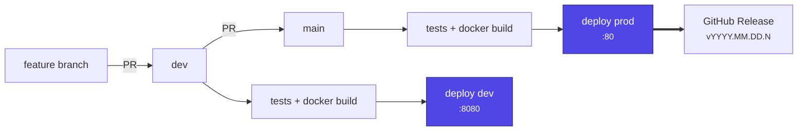
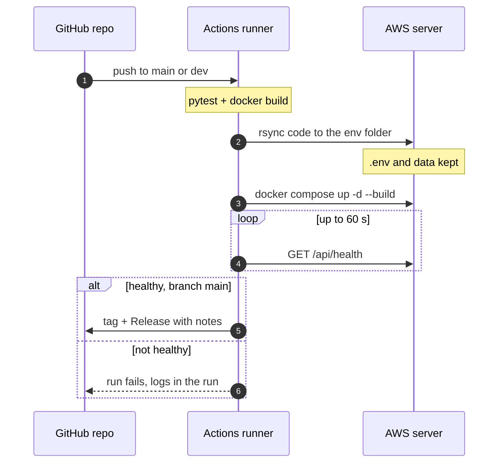

# Deploy, environments and releases

Every push to `main` or `dev` is tested, built and deployed to one AWS server by GitHub Actions
([`.github/workflows/ci-cd.yml`](../.github/workflows/ci-cd.yml)). A deploy of `main` also creates a GitHub Release.

| Branch | Environment | URL | Server folder | Release |
|---|---|---|---|---|
| `main` | prod | http://13.218.176.204/ | `/opt/doomsday_freedom_broker` | yes, `vYYYY.MM.DD.<run>` |
| `dev` | dev | http://13.218.176.204:8080/ | `/opt/doomsday_freedom_broker-dev` | no |

Each environment has its own container, image, `.env` and data volume (SQLite DB + logs), so testing on dev never touches prod data.

## Flow



Pull requests into `dev` or `main` run only the tests and the Docker build; nothing is deployed until the merge.

### What one deploy does



The running version is written to `RELEASE` in the env folder (`version sha time`).

## Releases and rollback

- **Release:** merge `dev` into `main`. After the prod deploy is healthy, the workflow creates the tag and a Release with auto-generated notes (commits and PRs since the last release). No manual tagging.
- **Rollback:** GitHub → **Actions** → **CI/CD** → **Run workflow**, branch `main`, `ref` = an older release tag (e.g. `v2026.11.07.12`). It runs the tests, deploys that exact code to prod, and does not create a new release.
- **Redeploy** the current head (e.g. after editing the server `.env`): same button, leave `ref` empty.

> [!NOTE]
> Rollback changes the code only. The database stays as it is; restore it separately if needed (below).

## Server

`ssh ubuntu@13.218.176.204`. Docker + Compose, Docker logs capped at 3 × 10 MB per container, 4 GB swap.

```text
/opt/doomsday_freedom_broker/        # prod (main), port 80
├── .env                             # settings and API keys, server only, mode 600
├── RELEASE                          # deployed version
└── …                                # code, replaced on every deploy
/opt/doomsday_freedom_broker-dev/    # dev, port 8080, same layout
~/db-backups/                        # manual DB backups
```

| Volume | Holds |
|---|---|
| `doomsday_freedom_broker_cqa-state` | prod `cqa.sqlite3` + logs |
| `doomsday_freedom_broker-dev_cqa-state` | dev `cqa.sqlite3` + logs |

### Settings (`.env`)

Created once from [`.env.example`](../.env.example); deploys never overwrite or delete it. After editing, restart that environment:

```bash
cd /opt/doomsday_freedom_broker      # or …-dev
nano .env
docker compose up -d --force-recreate   # dev: APP_PORT=8080 docker compose up -d --force-recreate
```

### Database backup and restore

```bash
cd /opt/doomsday_freedom_broker
docker compose cp app:/app/state/cqa.sqlite3 ~/db-backups/prod-$(date +%Y%m%d-%H%M).sqlite3   # backup

docker compose stop app                                        # restore
docker compose cp ~/db-backups/<file>.sqlite3 app:/app/state/cqa.sqlite3
docker compose start app
```

> [!WARNING]
> The databases contain real customer dialogs and calls. Never commit them to git, and keep copies off public places.

## GitHub settings

| Secret | Value |
|---|---|
| `SSH_HOST` | server IP |
| `SSH_USER` | `ubuntu` |
| `SSH_KEY` | private key of the deploy key (its public half is in the server's `~/.ssh/authorized_keys`) |

The workflow uses environments `production` (main) and `development` (dev); GitHub creates them on the first run. Protect `main` and `dev` with a ruleset that requires the `build` check.

## Troubleshooting

| Symptom | Fix |
|---|---|
| Deploy fails at "Configure SSH" / "Sync code" | Check the 3 secrets; the server IP changes if the EC2 instance is stopped and started |
| Health check fails | The run prints `docker compose logs`; on the server run `docker compose logs -f` in the env folder |
| App says `provider: mock` | `.env` missing or `LLM_PROVIDER` not `openai`; fix `.env` and restart |
| Site works on the server but not from outside | Open the port (80 / 8080) in the EC2 security group |
